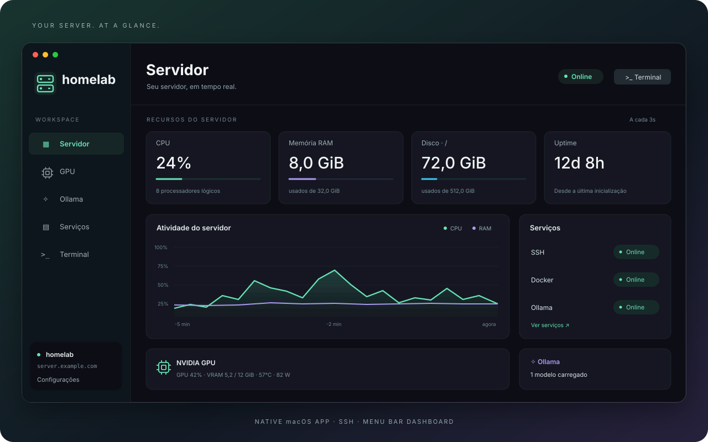

# my-homelab

A native dashboard for monitoring your Linux server from macOS. View system resources, NVIDIA GPU metrics, Ollama models, and services, or open an SSH session — from the main window or directly from the menu bar.

Built with **SwiftUI, AppKit, Swift Charts, and SwiftTerm**. Interface in Brazilian Portuguese. No web interface and no agent to install on the server.



*Illustration with example data. No real server information is shown.*

## Features

- **Server:** connection status, CPU, load average, used/total RAM, root disk usage, and uptime.
- **NVIDIA GPU:** utilization, VRAM, temperature, power, fan speed, clocks, and compute/CUDA processes. Multiple GPU support.
- **Ollama:** API availability, models loaded into memory, VRAM, size, parameters, and quantization.
- **Services:** SSH, Docker, and Ollama. Counts of total containers, running containers, and containers with failing health checks.
- **Terminal:** tabbed SSH sessions, colors, selection, copy/paste, resizing, and font size adjustment.
- **Virtual machines:** libvirt VMs with state, vCPUs, RAM, disk, address, and guest readiness. Start, safe shutdown, restart, SSH into the guest, and a one-click **Open desktop** over an SSH tunnel.
- **Menu bar:** a compact dashboard with metrics and controls, even when the main window is closed.
- **History:** CPU, RAM, GPU, and VRAM charts covering the last five minutes, kept only in memory.

The `nvidia-smi` and `nvtop` commands supply data to native components; their raw output is not displayed in the monitor.

## Requirements

### Mac

- macOS 14 or later.
- Xcode with Swift 6 or later and the command-line tools selected.
- GitHub access to download dependencies during the first build.

### Server

- Linux with Python 3 and SSH access.
- SSH key/agent authentication for automatic monitoring.
- For the corresponding metrics: NVIDIA driver and `nvidia-smi`, `nvtop` with JSON `--snapshot` support, Docker, and Ollama.
- For virtual machines (optional): libvirt/KVM, see [Virtual machines](#virtual-machines).

Unavailable optional services are reported without blocking the rest of the dashboard.

## Getting started

```sh
git clone https://github.com/joaoantoniocoelho/my-homelab.git
cd my-homelab
./scripts/build-app.sh
open dist/Homelab.app
```

The script generates the complete application, including its icon, resources, and an ad hoc signature for local use. You can copy `dist/Homelab.app` to **Applications**. The distribution is not notarized by Apple.

For a development build:

```sh
./scripts/build-app.sh debug
```

The build uses `--build-system native` to avoid depending on ahead-of-time Metal shader compilation by Swift Build. SwiftTerm supports loading shaders at runtime. Dependency versions are pinned in `Package.swift` and `Package.resolved`.

## Configuring the connection

The default destination is the generic name **`homelab`**, with no fixed username. In **Settings** (`⌘,`), enter your host/IP, username, and port.

You can also define a host in your **local** `~/.ssh/config` file:

```sshconfig
Host homelab
    HostName server.example.com
    User your-user
    Port 22
```

Replace these values with your server details. In the app, use `homelab` as the host and leave the username empty to inherit it from the SSH configuration. The port entered in the app takes precedence over the SSH file.

A shell alias, such as `alias homelab='ssh ...'`, is not interpreted by the app: use the connection fields or a host defined in `~/.ssh/config`.

The app uses `/usr/bin/ssh`, your existing keys and agent, including `SSH_AUTH_SOCK`. Standard server host key verification is preserved. The app does not implement password storage; authentication is delegated to OpenSSH.

Telemetry uses `BatchMode=yes`. If you need to confirm the server's host key or authenticate interactively, use the app's terminal. For automatic updates, the key must be available to SSH without prompts.

## Usage and refresh intervals

| Group | Default | Available intervals |
|---|---:|---:|
| CPU, RAM, load, GPU, and processes | 3 s | 2–5 s |
| Docker, Ollama, and loaded models | 8 s | 5–10 s |
| Disk and uptime | 45 s | 30–60 s |

Each group runs independent collections, with timeouts and no overlapping requests within the same group. The interval is measured between start times; a slow collection may delay the next one. The menu bar dashboard shares the main window's data without additional queries.

- **Close the window / `⌘W`:** keeps the app in the menu bar, preserving monitoring and SSH sessions. The Dock icon disappears while the window is closed.
- **Pause:** stops data collection while preserving terminal sessions. Reopening the window keeps monitoring paused.
- **Refresh / `⌘R`:** resumes collection and immediately queries all groups.
- **Server → Disconnect all:** pauses monitoring, ends SSH sessions, and closes VM tunnels (VMs keep running).
- **Power button / `⌘Q`:** quits the application and closes its connections.
- **`⌘1` through `⌘6`:** switch between the main window's screens.

In the menu bar, the GPU, Ollama, and services cards open their detail screens. The footer provides refresh, pause, main dashboard, terminal, settings, and quit controls.

## Virtual machines

The **VMs** screen lists every libvirt domain on `qemu:///system`. Nothing is hardcoded to a specific VM; each one gets its own settings (menu **⋯ → Configurar…**). Discovery reuses the monitoring SSH connection: a small Python helper (`vm.py`, sent like the collector and never installed) runs `virsh` on the server. The list refreshes every 15 s while monitoring is active, with one SSH process per refresh. The menu bar shows a row per VM with its state and an **Open desktop** button.

### Host requirements (Ubuntu server)

- KVM/QEMU with libvirt, and `virsh` (`libvirt-clients`) and Python 3 on the server.
- The SSH user must be in the `libvirt` group, so that `virsh -c qemu:///system list --all` works **without sudo**. The app never uses sudo on the host.
- No graphical environment, agent, or extra service is needed on the host.
- If libvirt is missing or inaccessible, the VMs screen says so and the rest of the dashboard keeps working.

### Guest requirements

- An SSH server reachable from the host, with public-key authentication for your Mac's key.
- For the desktop: an RDP server, such as XRDP with Xorg (port 3389 by default).
- A network address libvirt can report. On the `default` NAT network, the DHCP lease is used (an ARP fallback is tried next). For static IPs, set the address in the VM's settings.
- Autostart can stay disabled: the app starts the VM only when asked.

### VM settings

| Setting | Default | Notes |
|---|---|---|
| Guest SSH user | empty | Empty uses your SSH default user. |
| Guest address | automatic | DHCP lease/ARP from libvirt; set it only for static IPs. |
| SSH port / RDP port | 22 / 3389 | Ports inside the guest. |
| Local tunnel port | 3390, 3391, … | Each new VM gets the next port not used by another VM. |
| Client | Windows App | Any installed app that opens `.rdp` files, or the system default. |

Settings are stored in `UserDefaults`; no passwords are stored.

### One-click desktop

**Open desktop**:

1. Reads the domain state from libvirt. A running VM is reused and never restarted.
2. If the VM is shut off, starts it (`virsh start`).
3. Waits for the guest: "running" in libvirt is not "ready". From the host, the app checks the guest's SSH banner and performs a real RDP handshake (X.224) on the RDP port, every 2 s, for up to 3 minutes. There are no fixed delays.
4. Opens `ssh -N -L 127.0.0.1:<local>:<guest>:<rdp>` through the server, with `ExitOnForwardFailure`, keepalives, and no connection multiplexing.
5. Repeats the RDP handshake **through the tunnel**.
6. Writes `~/Library/Application Support/Homelab/RDP/<vm>.rdp` (address and username only, mode 600) and opens it with the configured client.

Progress is shown on the VM card and can be cancelled. Repeated clicks join the flow already running, so they never create a second start or tunnel. Each failure (libvirt, guest not ready, XRDP down, port in use, tunnel or client error) is reported with its cause.

**Windows App integration.** The Windows App (`com.microsoft.rdc.macos`) declares itself the owner of the `.rdp` document type. Opening a generated `.rdp` file starts the connection right away (verified with Windows App 11.4). It also registers the `rdp:` and `ms-rd:` URL schemes, but the app does not use them: the `.rdp` document is the documented and verifiable integration. Depending on its version, Windows App may also list the opened file among its connections, and it will ask for the guest password (it can store it in its own keychain). To use another client, choose it in the VM settings. Any app that opens `.rdp` files works without code changes.

### Tunnels

- They listen on `127.0.0.1` only; RDP is never exposed to the LAN or the internet.
- Before connecting, the app checks that the local port is free. A port used by another program is reported as a conflict and that program is never terminated.
- A tunnel stays open after the RDP window closes, so reopening is instant. It closes when you click ✕ next to it, change the VM settings, the VM shuts down, or Homelab quits. Monitoring settings changes and **Disconnect all** also close it.
- After a crash, Homelab cleans up on the next launch. It stops a leftover tunnel only when that process is orphaned and runs exactly the command Homelab recorded. Other SSH processes are never touched.
- A tunnel that drops (network, server reboot) shows as inactive; **Open desktop** opens a new one.

### Shutdown and restart

Closing the RDP client or Homelab **never** shuts down a VM. Shutdown is always explicit:

1. **Guest first:** over SSH into the guest (jumping through the server with your Mac's keys), the app runs `systemctl --no-ask-password poweroff`, then `sudo -n systemctl poweroff`. It never prompts and never stores a password.
2. **If the guest asks for a password** (the default on Kali), the card offers **Type password in terminal**. A tab of the app's terminal runs `sudo systemctl poweroff` in the guest. You type the password straight into `sudo`; it is not stored or logged. The app keeps watching libvirt until the VM is off.
3. **If the guest's SSH does not answer,** an ACPI request (`virsh shutdown --mode acpi`) is sent. Some guests, such as desktops whose power-button action is "ask", ignore it.
4. **Force shutdown** (`virsh destroy`) is available only from the ⋯ menu, or after a failed shutdown, with a confirmation. It is equivalent to pulling the plug.

**Restart** is a safe shutdown followed by a start. If the password step is needed, the start resumes once the VM is off.

To shut down without typing a password, you can optionally configure, **inside the guest only**, a scoped sudoers rule such as `youruser ALL=(root) NOPASSWD: /usr/bin/systemctl poweroff`, or install `qemu-guest-agent` and add its channel to the domain. The app does neither for you, and never sets up global passwordless sudo.

### Security

- All SSH, both to the server and to the guest via `ProxyJump`, uses `/usr/bin/ssh` with your keys, agent, and normal host-key verification. Guest commands run in `BatchMode`.
- VM names are validated against a conservative pattern before reaching any command. Remote arguments are shell-quoted, and the helper calls `virsh` with argument lists (`--domain <name>`), never a shell.
- Guest addresses, from configuration or libvirt, are validated before they are used in `ssh` arguments.
- The `.rdp` file contains no credentials.

### Troubleshooting

| Symptom | What to check |
|---|---|
| "Libvirt indisponível" | `ssh homelab virsh -c qemu:///system list --all` must work without sudo (group `libvirt`, then log in again). |
| VM running, "Aguardando convidado" | The guest is booting, or its SSH/RDP services are not answering; check the guest's network and services. |
| "Sem endereço de rede" | No DHCP lease: set the guest address manually in the VM settings. |
| Stuck on "Desligando" | Some guests take minutes to stop (systemd stop jobs). SSH and RDP stop first, so the app keeps watching libvirt until the VM is off. Use **Force shutdown** only if it never finishes. |
| SSH ready, desktop not | `systemctl status xrdp` in the guest; the RDP port in the settings must match. |
| "Porta local … em uso" | Another process (often a manual `ssh -L`) holds the port: close it or choose another local port. |
| Guest SSH fails / host key | Open **Terminal SSH** once to accept the guest's host key, and check that your key is authorized in the guest. |
| Client does not open | Install Windows App or choose another `.rdp` client in the VM settings. |

### Known limitations

- Without a guest agent, readiness is inferred from the guest's SSH and RDP ports.
- Only `qemu:///system` is supported. Paused/suspended domains are shown but not resumed by the app.
- The app does not render RDP itself; it relies on the installed client.

## Where does the data come from?

The Python collector uses only the standard library. It is sent and executed over SSH for each query; it does not install packages, write an agent to the server, or modify its services.

| Data | Source and interpretation |
|---|---|
| CPU | Delta of `/proc/stat` counters, sampled over at least 250 ms. Guest time is not counted twice. |
| RAM | `/proc/meminfo`: used = `MemTotal − MemAvailable`. |
| Load | Linux load average over 1, 5, and 15 minutes. |
| Disk | Filesystem mounted at `/`, via `shutil.disk_usage`. |
| Uptime | `/proc/uptime`. |
| GPU | `nvidia-smi --query-gpu`, as structured CSV. |
| CUDA processes | `nvidia-smi --query-compute-apps`. |
| Clocks | `nvtop --snapshot`, as JSON. |
| Containers | `docker ps --all --format '{{json .}}'`. |
| Docker service | `systemctl show docker.service`, as a fallback when the Docker API is inaccessible. |
| Ollama | `GET http://127.0.0.1:11434/api/ps`, accessed from within the server. |

### Interpreting the metrics

- **Installed does not mean loaded:** the Ollama dashboard lists models in RAM/VRAM. Models only stored on disk do not appear in this list.
- **CPU is a short sample:** it may differ from `top` and include the work performed by monitoring itself.
- **Units:** RAM, disk, and VRAM are shown in MiB/GiB; rounded numbers may differ from tools configured to use MB/GB.
- **Disk:** other volumes are not added to root disk usage.
- **GPU processes:** the list covers compute/CUDA, not all graphics processes.
- **nvtop:** versions without JSON snapshots do not provide clocks. The remaining NVIDIA metrics stay available. Clocks are matched by name only when that name is unique, because the snapshot does not provide a UUID.
- **Docker:** the total includes stopped containers; `running` counts `State == running`; `unhealthy` counts `(unhealthy)` in `Status`. Containers without health checks are not considered tested. If the SSH user cannot query the API, counts are unavailable; the app does not use `sudo` or change permissions.
- **Failures and pause:** the last result may remain visible with a warning. Check the last collection indicator. Missing metrics are shown as `—`.

## Tests

Local tests, without requiring a server:

```sh
swift test --build-system native
python3 -m unittest discover -s Tests -p 'test_*.py' -v
```

These cover parsing, missing data, response framing, connection validation, quoting, timeouts/cancellation, CSV, Docker counters, and collection group isolation. The VM tests cover state parsing and discovery, command construction and quoting, start/shutdown/restart flows, guest readiness, RDP handshakes over real sockets, tunnel lifecycle (conflicts, early exit, timeout, cancellation, orphan cleanup), duplicate requests, and timeouts.

After configuring the `homelab` SSH alias, validate all three groups against the server (it also lists VMs, read-only):

```sh
dist/Homelab.app/Contents/MacOS/Homelab --smoke-test
```

This command uses the default destination `homelab` and port 22, not the interface's saved preferences.

To verify rendering and window closing/reopening, with the app not running:

```sh
open dist/Homelab.app --args --capture-ui /tmp/homelab-preview
```

This routine captures only the app's own screens, opens an SSH session, and checks that collection, pause state, and the session are preserved when closing/reopening. **The images contain real server data; do not publish them without reviewing them.**

## Privacy and local files

- The repository's default configuration contains no IP address, SSH username, or credentials for a specific server.
- Connection preferences are stored in macOS `UserDefaults`, outside the project. Metric history stays in memory.
- VM settings live in `UserDefaults`; the generated `.rdp` files and the tunnel PID records live in `~/Library/Application Support/Homelab/`, and none of them contains credentials.
- The collector accesses the Ollama API through the server's loopback interface; it does not need to be exposed on the network.
- `.gitignore` excludes builds, generated applications, caches, environment files, common key formats, captures, and local logs.
- Do not add SSH keys, passwords, tokens, configuration exports, dumps, captures, or terminal recordings without reviewing their contents. `.gitignore` does not detect secrets embedded in code or protect files added by force.

## Structure

```text
Sources/Homelab/          Interface, menu bar, SSH sessions, and scheduling
Sources/HomelabCore/      Connection, models, process execution, Python collector, libvirt helper, tunnels, and VM flows
Tests/                   Swift and Python tests
Resources/               Application metadata
scripts/                 Build, packaging, and icon generation
```

The terminal uses [SwiftTerm](https://github.com/migueldeicaza/SwiftTerm), licensed under MIT. The dependency's license is included in the generated app.
